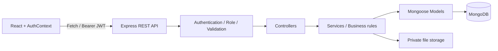

# Classroom — Hệ thống Lớp học Trực tuyến

Ứng dụng MERN quản lý lớp học với ba vai trò **Admin**, **Teacher** và **Student**. Giảng viên tạo khóa học, chia sẻ tài liệu, giao bài và chấm điểm; sinh viên ghi danh, học và nộp bài; quản trị viên quản lý người dùng và danh mục.

Giao diện tiếng Việt, bố cục responsive và font Noto Sans được đóng gói cùng frontend. Dữ liệu được lưu trong MongoDB; các thao tác được kiểm soát bằng JWT, role và quyền trên từng tài nguyên.

## Mục lục

- [Chức năng và phân quyền](#chức-năng-và-phân-quyền)
- [Công nghệ](#công-nghệ)
- [Kiến trúc và cấu trúc thư mục](#kiến-trúc-và-cấu-trúc-thư-mục)
- [Cài đặt và chạy cục bộ](#cài-đặt-và-chạy-cục-bộ)
- [Biến môi trường](#biến-môi-trường)
- [Kiểm thử và build](#kiểm-thử-và-build)
- [Quy ước Git](#quy-ước-git)
- [Xử lý lỗi thường gặp](#xử-lý-lỗi-thường-gặp)
- [Giới hạn hiện tại](#giới-hạn-hiện-tại)
- [Tài liệu chi tiết](#tài-liệu-chi-tiết)

## Chức năng và phân quyền

| Vai trò | Chức năng |
| --- | --- |
| Khách | Tìm kiếm/lọc khóa học đã xuất bản, xem giới thiệu, đăng ký Student, đăng nhập |
| Admin | Tạo Teacher/Student; sửa họ tên/email của hai vai trò này; khóa/mở khóa; đặt lại mật khẩu Teacher/Student; tự đổi mật khẩu; CRUD/vô hiệu hóa danh mục |
| Teacher | CRUD khóa học của mình; xuất bản/lưu trữ; CRUD tài liệu text/PDF/video link; CRUD bài tập; xem ghi danh; đánh dấu hoàn thành; xem bài nộp và chấm/sửa điểm |
| Student | Ghi danh/hủy/ghi danh lại; xem tài liệu; tải PDF; nộp text/file; sửa bài chưa chấm trước hạn; xem điểm và nhận xét |
| Đã đăng nhập | Xem hồ sơ cá nhân, sửa họ tên và đăng xuất |

Admin quản lý người dùng và danh mục. Quyền sửa khóa học/chấm bài thuộc Teacher sở hữu khóa học; quyền xem bài nộp thuộc Student tác giả hoặc Teacher sở hữu.

Hồ sơ hiện có họ tên, email, role và trạng thái hoạt động. Khi Admin đổi email Student/Teacher, email mới được dùng để đăng nhập; mật khẩu và dữ liệu học tập được giữ nguyên. Admin tự đổi mật khẩu bằng mật khẩu hiện tại; khi đổi/reset mật khẩu, token cũ của tài khoản đó bị vô hiệu hóa.

## Công nghệ

| Thành phần | Công nghệ trong mã nguồn |
| --- | --- |
| Frontend | React 19, Functional Components, Hooks, React Context, React Router 7 |
| Giao diện | Tailwind CSS 4, Lucide React, Noto Sans Variable |
| Build frontend | Vite 8 |
| Backend | Node.js, Express 5, REST API |
| Database | MongoDB, Mongoose 9 |
| Xác thực và validation | JWT HS256, bcryptjs, Zod |
| HTTP và upload | Helmet, CORS, express-rate-limit, Multer |
| Kiểm thử | Node Test Runner, Supertest, Vitest, React Testing Library, jsdom |

Phiên bản dependency cụ thể được ghi trong [server/package.json](server/package.json), [client/package.json](client/package.json) và hai file `package-lock.json` tương ứng.

## Kiến trúc và cấu trúc thư mục



Trong môi trường phát triển, trình duyệt gọi `/api/v1` trên Vite; Vite proxy request đến backend. Khi triển khai bản build, cần cấu hình reverse proxy `/api` hoặc đặt `VITE_API_URL` trỏ đến backend.

```text
online_classroom/
├── client/
│   ├── public/                    # Favicon và tài nguyên public
│   ├── src/
│   │   ├── api/                   # HTTP client, API modules, tải file
│   │   ├── components/            # UI chung, khóa học, bài tập
│   │   ├── contexts/              # Auth và thông báo
│   │   ├── hooks/                 # Query và mutation
│   │   ├── layouts/               # Sidebar, topbar, mobile navigation
│   │   ├── pages/                 # Màn hình và admin/
│   │   ├── routes/                # Lazy routes, ProtectedRoute
│   │   ├── test/                  # Frontend tests
│   │   ├── utils/
│   │   ├── App.jsx
│   │   ├── main.jsx
│   │   └── index.css
│   ├── .env.example
│   ├── package.json
│   └── vite.config.js
├── server/
│   ├── src/
│   │   ├── config/                # Environment và MongoDB
│   │   ├── controllers/
│   │   ├── middlewares/           # JWT, role, validation, upload, errors
│   │   ├── models/                # 7 Mongoose models
│   │   ├── routes/
│   │   ├── services/              # Quyền tài nguyên và nghiệp vụ
│   │   ├── utils/
│   │   ├── app.js                 # Cấu hình Express
│   │   └── server.js              # Kết nối DB, mở cổng, shutdown
│   ├── scripts/                   # Seed Admin, syntax check, QA fixture
│   ├── tests/                     # Backend integration tests
│   ├── uploads/                   # File riêng tư, được Git bỏ qua
│   ├── .env.example
│   └── package.json
├── docs/
│   ├── api-docs.md
│   ├── architecture.md
│   ├── database-design.md
│   └── user-guide.md
├── .gitignore
└── README.md
```

## Cài đặt và chạy cục bộ

Các lệnh dưới đây dùng **PowerShell trên Windows**. Bắt đầu tại thư mục `online_classroom`. Dự án có hai package riêng; cài dependency trong `server` và `client`.

### 1. Chuẩn bị

- Node.js **từ 22.19.0 trở lên**, có npm.
- MongoDB Server đang chạy cục bộ hoặc một database MongoDB Atlas có thể kết nối.
- MongoDB Compass để xem dữ liệu, nếu cần. Compass là công cụ quản lý; ứng dụng vẫn cần MongoDB Server/Atlas.
- Git để quản lý mã nguồn.

Kiểm tra công cụ:

```powershell
node --version
npm --version
git --version
```

### 2. Cài backend và tạo cấu hình

```powershell
cd server
npm ci
if (-not (Test-Path -LiteralPath '.env')) {
    Copy-Item -LiteralPath '.env.example' -Destination '.env'
}
node -e "console.log(require('node:crypto').randomBytes(48).toString('hex'))"
```

Mở `server/.env`, dán chuỗi ngẫu nhiên vừa tạo vào `JWT_SECRET`. Các giá trị cục bộ mặc định:

```dotenv
MONGODB_URI=mongodb://127.0.0.1:27017/online_classroom
PORT=5000
CLIENT_ORIGIN=http://127.0.0.1:5173
```

`JWT_SECRET` trong file mẫu để trống và phải được điền trước khi chạy. Giữ file `.env` hiện có nếu bạn đã cấu hình; không ghi đè bằng mẫu.

Với MongoDB Atlas, thay `MONGODB_URI` bằng connection string của database đã cấp quyền. Tên database nên được chỉ rõ trong URI. Không đưa URI có thông tin đăng nhập vào mã nguồn, frontend hoặc Git.

### 3. Tạo Admin đầu tiên

Trong `server/.env`, điền `ADMIN_NAME`, `ADMIN_EMAIL` và `ADMIN_PASSWORD` theo tài khoản bạn muốn tạo. Mật khẩu tối thiểu 12 ký tự và tối đa 72 byte UTF-8.

Từ thư mục `server`:

```powershell
npm run seed:admin
```

Kết quả thành công: `Đã tạo tài khoản Admin.` Xóa giá trị `ADMIN_PASSWORD` khỏi `.env` sau khi tạo xong.

Ứng dụng không có tài khoản Admin mặc định. Nếu email đã tồn tại, script dừng và không ghi đè role hoặc mật khẩu. Đăng ký công khai chỉ tạo Student; Admin tạo Teacher qua giao diện Quản lý người dùng.

### 4. Chạy backend — terminal thứ nhất

Tại thư mục `server`:

```powershell
npm run dev
```

Backend kết nối MongoDB và khởi tạo models/indexes trước khi mở cổng HTTP. API mặc định: `http://127.0.0.1:5000/api/v1`.

Mở `http://127.0.0.1:5000/health`, hoặc gọi từ terminal khác:

```powershell
Invoke-RestMethod -Uri 'http://127.0.0.1:5000/health'
```

Response JSON tương ứng:

```json
{"success":true,"data":{"status":"ok"}}
```

`/health` kiểm tra tiến trình HTTP đang phục vụ; nó không truy vấn lại MongoDB ở mỗi lần gọi.

Trong Compass, kết nối `mongodb://127.0.0.1:27017`, Refresh và mở database `online_classroom`. Backend tự tạo các collections: `users`, `categories`, `courses`, `enrollments`, `materials`, `assignments`, `submissions`; không cần tạo từng collection bằng tay.

### 5. Chạy frontend — terminal thứ hai

Mở terminal mới tại thư mục gốc dự án:

```powershell
cd client
npm ci
npm run dev
```

Mở **http://127.0.0.1:5173**. Cấu hình mặc định đã proxy `/api` tới backend cổng 5000; không cần `.env` frontend nếu giữ các giá trị này.

Nếu backend dùng cổng khác, tạo `client/.env` từ [file mẫu](client/.env.example), sửa `BACKEND_TARGET` và khởi động lại Vite. Nếu terminal từng dùng QA fixture, đặt lại target:

```powershell
$env:BACKEND_TARGET = 'http://127.0.0.1:5000'
npm run dev
```

Nếu 5173 đã có tiến trình khác, dùng cổng 5174:

```powershell
npm run dev -- --port 5174
```

Khi dùng URL API trực tiếp thay vì proxy, `CLIENT_ORIGIN` của backend phải khớp origin frontend, bao gồm protocol, hostname và port. `localhost` và `127.0.0.1` là hai hostname khác nhau.

### 6. Thử luồng học tập đầu tiên

1. Admin đăng nhập, tạo danh mục và tài khoản Teacher.
2. Teacher đăng nhập, tạo khóa học, thêm tài liệu và bài tập.
3. Teacher xuất bản khóa học và bài tập. Cả hai ban đầu là `draft`.
4. Student đăng ký, đăng nhập và ghi danh khóa học.
5. Student xem tài liệu và nộp bài.
6. Teacher mở bài tập, xem bài nộp và lưu điểm/nhận xét.
7. Student mở lại bài tập để xem kết quả.

Các thao tác theo vai trò và điều kiện chi tiết được trình bày trong [Hướng dẫn sử dụng](docs/user-guide.md).

## Biến môi trường

### Backend — `server/.env`

| Biến | Mặc định / yêu cầu | Ý nghĩa |
| --- | --- | --- |
| `NODE_ENV` | `development` | `development`, `test` hoặc `production` |
| `PORT` | `5000` | Cổng HTTP, từ 1 đến 65535 |
| `MONGODB_URI` | Bắt buộc | URI `mongodb://` hoặc `mongodb+srv://`, có tên database |
| `JWT_SECRET` | Bắt buộc, ít nhất 32 ký tự | Khóa ký JWT, dùng chuỗi ngẫu nhiên riêng |
| `JWT_EXPIRES_IN` | `1h` | Thời hạn dạng số và đơn vị `s`, `m`, `h`, `d` |
| `CLIENT_ORIGIN` | Mẫu: `http://127.0.0.1:5173` | Origin frontend cho CORS; giá trị mặc định trong code là `http://localhost:5173` |
| `UPLOAD_DIR` | `uploads` | Thư mục upload; đường dẫn tương đối tính từ `server/` |
| `MAX_FILE_SIZE_MB` | `10` | Giới hạn backend 1–25 MB/file; UI hiện dùng 10 MB |
| `ADMIN_NAME` | `Administrator` khi seed | Tên Admin đầu tiên |
| `ADMIN_EMAIL` | Bắt buộc khi seed | Email Admin đầu tiên |
| `ADMIN_PASSWORD` | Bắt buộc khi seed | Mật khẩu ban đầu, xóa giá trị sau khi seed |

### Frontend — `client/.env` tùy chọn

| Biến | Mặc định | Ý nghĩa |
| --- | --- | --- |
| `VITE_API_URL` | `/api/v1` | Base URL được đóng gói vào mã chạy trên trình duyệt |
| `BACKEND_TARGET` | `http://127.0.0.1:5000` | Đích proxy của Vite dev/preview, không phải biến gửi cho client |

Mọi biến `VITE_*` được sử dụng trong frontend có thể bị người dùng trình duyệt đọc. Chỉ đặt cấu hình công khai ở đây; JWT secret, mật khẩu seed và URI MongoDB thuộc backend.

### Dữ liệu QA tạm

[Helper QA](server/scripts/previewFixture.js) phục vụ backend mẫu ở cổng **5501**, tự mở MongoDB và thư mục tạm riêng. Nó không dùng database `online_classroom` trong `.env`. Tài khoản QA và cách chạy được ghi trong [frontend README](client/README.md#preview-qa-độc-lập-tùy-chọn).

Dữ liệu này dùng để thử giao diện và được dọn khi dừng helper bình thường bằng Ctrl+C. Trỏ frontend về cổng **5000** để sử dụng database thật của bạn.

## Kiểm thử và build

Từ thư mục gốc, chạy kiểm tra backend:

```powershell
cd server
npm run check
npm test
```

Backend integration tests cần `mongod` trên PATH. Nếu MongoDB được cài tại đường dẫn khác, đặt đường dẫn thực tế trước khi chạy:

```powershell
$env:MONGOD_BINARY = 'C:\Program Files\MongoDB\Server\8.0\bin\mongod.exe'
npm test
```

Thay đường dẫn trên theo phiên bản đã cài. Tests tạo một MongoDB process, cổng trống, database và thư mục upload tạm riêng; không xóa database phát triển. Cần quyền tạo tiến trình con và mở cổng loopback. Không cần chạy backend dev server để chạy tests.

Trong terminal khác từ thư mục gốc, kiểm tra frontend và tạo bản build:

```powershell
cd client
npm test
npm run build
```

Frontend tests chạy bằng jsdom và mock HTTP, không cần backend/MongoDB. Đây là kiểm thử component và luồng client; không thay thế kiểm tra trực tiếp bằng trình duyệt. Các nhóm kiểm thử bao gồm đăng nhập/phân quyền, nộp bài/hiển thị điểm, đổi/reset mật khẩu, sửa hồ sơ và xử lý email trùng.

Build frontend tạo `client/dist/`. Để xem bản build cục bộ khi backend đang chạy:

```powershell
npm run preview
```

URL mặc định: `http://127.0.0.1:4173`. Preview dùng proxy như dev; khi triển khai thư mục `dist` lên hosting, proxy Vite không tự đi theo bản build. Cần cấu hình API routing và fallback SPA về `index.html` trên máy chủ triển khai. Backend production có thể khởi chạy bằng `npm start` từ `server` sau khi cấu hình môi trường phù hợp; dự án chưa có quy trình triển khai tự động.

## Quy ước Git

[`.gitignore`](.gitignore) loại trừ dependency, cấu hình bí mật, output build, coverage, log, file upload và các thư mục dữ liệu MongoDB cục bộ thường dùng.

- Commit mã nguồn, tài liệu, `package.json`, `package-lock.json` và `.env.example` không chứa bí mật.
- Không commit `node_modules/`, `.env`, file upload, database hoặc bản sao lưu dữ liệu thật.
- Giữ `server/uploads/.gitkeep` để duy trì cấu trúc thư mục rỗng.
- `.gitignore` không tự bỏ theo dõi file đã từng được commit. Kiểm tra danh sách file trước khi commit và xử lý riêng nếu một file bí mật đã được đưa vào Git.

Kiểm tra trước khi commit:

```powershell
git status --short
git diff --check
git check-ignore server/.env client/.env server/node_modules client/node_modules client/dist server/uploads/example.pdf
```

Lệnh `git check-ignore` chỉ kiểm tra quy tắc và có thể dùng tên file mẫu chưa tồn tại. Các file `.env.example` phải được phép theo dõi.

## Xử lý lỗi thường gặp

| Hiện tượng | Cách kiểm tra và xử lý |
| --- | --- |
| `Invalid environment variables` | Kiểm tra tên biến được báo lỗi trong `server/.env`, đặc biệt `JWT_SECRET` và `MONGODB_URI`; chạy lệnh từ `server/` |
| Backend không kết nối MongoDB | Kiểm tra MongoDB Server đang chạy, URI và tên database; với Atlas kiểm tra database user và quyền truy cập mạng |
| Compass không có `online_classroom` | Refresh đúng kết nối; kiểm tra URI backend có cùng host và tên database; chạy backend thật, không chỉ QA fixture |
| Vite báo cổng 5173 đã được dùng | Dùng tiến trình đang chạy đúng dự án hoặc chạy với `-- --port 5174`; không cần đổi dữ liệu MongoDB |
| Không kết nối được API / proxy lỗi | Kiểm tra backend cổng 5000, `BACKEND_TARGET`, `VITE_API_URL`; khởi động lại Vite sau khi đổi cấu hình |
| CORS khi gọi API trực tiếp | `CLIENT_ORIGIN` phải khớp URL frontend; phân biệt `localhost` với `127.0.0.1` |
| Danh sách khóa học trống | Tạo danh mục hoạt động, Teacher tạo và xuất bản khóa học; bản nháp không xuất hiện ở danh sách công khai |
| Student chưa xem được bài tập | Kiểm tra ghi danh và bài tập đã xuất bản; xuất bản khóa học không tự xuất bản bài tập |
| Không nộp/sửa bài được | Cần ghi danh `active`, khóa học/bài tập `published`, chưa quá hạn; bài đã chấm không được sửa |
| `401` sau khi đổi mật khẩu | Token cũ đã hết hiệu lực; đăng nhập bằng mật khẩu mới. Admin tự đổi thành công được cấp token mới cho phiên hiện tại |
| Email trùng khi sửa hồ sơ | Dùng email khác; hệ thống không lưu một phần thay đổi khi bị trùng |
| `413` / `415` khi upload | Mặc định tối đa 10 MB/file; chỉ PDF/TXT UTF-8 cho bài nộp, PDF cho tài liệu; kiểm tra nội dung file đúng định dạng |
| `429` | Đã vượt giới hạn request; chờ cửa sổ giới hạn kết thúc thay vì thử liên tục |
| Backend test không tìm thấy `mongod` / `spawn EPERM` | Kiểm tra PATH hoặc `MONGOD_BINARY`; môi trường chạy test cần cho phép tạo tiến trình con |
| Font hoặc giao diện cũ | Chạy `npm ci` trong client sau khi dependency thay đổi, khởi động lại Vite và Ctrl+F5; font Noto Sans nằm trong bundle |
| Dữ liệu QA khác dữ liệu trong Compass | Preview 5501 dùng MongoDB tạm trên cổng riêng. Chuyển `BACKEND_TARGET` về backend thật 5000 |

## Giới hạn hiện tại

- Chưa có refresh token, xác minh email hoặc tự khôi phục mật khẩu qua email. Đăng xuất thông thường xóa token phía client; đổi/reset mật khẩu thu hồi token cũ bằng `tokenVersion`.
- Hồ sơ chưa có số điện thoại, địa chỉ hoặc ảnh đại diện upload. Mỗi khóa học hiện có một Teacher sở hữu.
- Upload dùng ổ đĩa cục bộ và buffer có giới hạn. Có kiểm tra định dạng nhưng chưa quét mã độc hoặc lưu trên object storage.
- Mỗi Student/Assignment lưu một bài nộp hiện tại; chưa có lịch sử các lần nộp. PUT thay toàn bộ text/file, cần chọn lại file muốn giữ.
- Unique indexes và optimistic concurrency bảo vệ một số thao tác ghi, nhưng nghiệp vụ liên collection/xóa nhiều document chưa chạy trong transaction. Cần hoàn thiện đồng bộ ghi và đối soát file trước khi dùng trong môi trường production nhiều người thao tác đồng thời.
- Rate limiter đang dùng bộ nhớ của một process; chưa cấu hình reverse proxy, shared rate-limit store hoặc CI/CD tự động.

## Tài liệu chi tiết

| Tài liệu | Nội dung |
| --- | --- |
| [Kiến trúc](docs/architecture.md) | Luồng request, phân lớp backend, frontend state, JWT và upload |
| [Database](docs/database-design.md) | ERD, 7 collections, indexes và quy tắc dữ liệu |
| [API](docs/api-docs.md) | Method, endpoint, role, payload, response và mã lỗi |
| [Hướng dẫn sử dụng](docs/user-guide.md) | Thao tác Admin/Teacher/Student và luồng demo |
| [Backend README](server/README.md) | Lệnh chạy, seed, upload, test và giới hạn backend |
| [Frontend README](client/README.md) | Routes, state, proxy, build và dữ liệu QA tạm |
