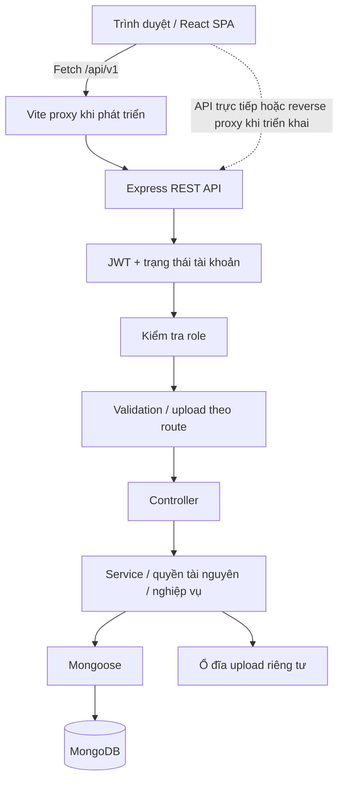
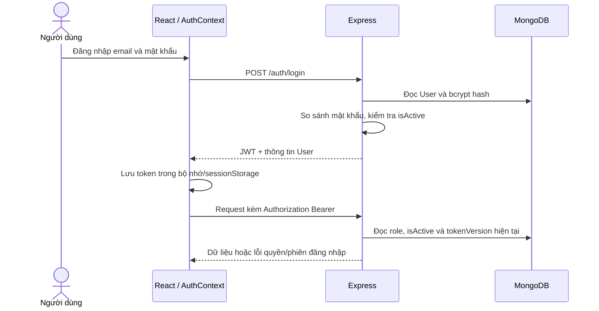

# Kiến trúc hệ thống

[README dự án](../README.md) · [Database](database-design.md) · [API](api-docs.md) · [Hướng dẫn sử dụng](user-guide.md)

## 1. Thành phần và luồng dữ liệu

Frontend và backend là hai Node packages độc lập, có `package.json` và lockfile riêng. Frontend không kết nối MongoDB trực tiếp. Không có SSR, WebSocket hoặc dịch vụ họp video trong phiên bản hiện tại; video học tập là liên kết do Teacher cung cấp.

## 2. Backend

| Lớp | Vị trí | Trách nhiệm |
| --- | --- | --- |
| Config | `server/src/config/` | Đọc/validate biến môi trường, kết nối MongoDB, khởi tạo indexes |
| Routes | `server/src/routes/` | Gắn method/path, xác thực, role, validation và controller |
| Middlewares | `server/src/middlewares/` | JWT, khóa tài khoản, role, ObjectId, request schema, upload, rate limit, lỗi |
| Controllers | `server/src/controllers/` | Nhận input đã validate, thực hiện truy vấn/gọi service, định dạng response |
| Services | `server/src/services/` | Kiểm tra quyền tài nguyên và xử lý nghiệp vụ nhiều bước |
| Models | `server/src/models/` | Schema, tham chiếu, indexes, timestamps và validation dữ liệu |
| Utils | `server/src/utils/` | AppError, response và phân trang |

`app.js` xuất ứng dụng Express để tests sử dụng mà không cần chạy dev server. `server.js` kết nối DB trước khi gọi `listen`, xử lý lỗi mở cổng và đóng kết nối khi nhận tín hiệu dừng.

Express 5 chuyển lỗi/rejected promise từ các handlers async vào middleware lỗi. `errorHandler` chuẩn hóa lỗi validation, duplicate key, xung đột phiên bản, upload, JSON và lỗi nội bộ. Response production không trả stack trace.

## 3. Ba lớp kiểm tra quyền

1. **Authentication:** JWT đúng chữ ký HS256, issuer, audience và thời hạn; tài khoản còn tồn tại, hoạt động và token chưa bị thu hồi.
2. **Role:** endpoint yêu cầu admin/teacher/student phù hợp.
3. **Tài nguyên:** Teacher sở hữu khóa học; Student có Enrollment hợp lệ hoặc là tác giả Submission, tùy thao tác.

ProtectedRoute của React chỉ hỗ trợ trải nghiệm điều hướng. Backend luôn kiểm tra quyền, bao gồm request được gửi trực tiếp ngoài frontend.

Ví dụ, biết `assignmentId` không đủ để xem bài nộp của người khác. Backend tìm khóa học chứa Assignment và kiểm tra quyền Teacher; Student chỉ được xem Submission có `student` bằng tài khoản của mình. Các route có cả `courseId` và ID con kiểm tra tài nguyên con thực sự thuộc khóa học đó.

## 4. Xác thực và quản lý mật khẩu

- Public registration luôn tạo Student; Admin được tạo bằng script seed, Teacher được Admin tạo.
- Mật khẩu mới có ít nhất 12 ký tự và không quá 72 byte UTF-8. Chỉ `passwordHash` được lưu, với bcrypt cost 12.
- `passwordHash` và `tokenVersion` không xuất hiện trong User JSON.
- JWT chứa subject là User ID và claim `ver`. Backend đối chiếu với `User.tokenVersion` ở mỗi request được bảo vệ.
- Admin tự đổi mật khẩu phải nhập mật khẩu hiện tại. Lưu mật khẩu mới đồng thời tăng tokenVersion; response trả token mới cho phiên đang thao tác.
- Admin chỉ đặt lại mật khẩu cho Student/Teacher. Người bị reset phải đăng nhập lại; các token cũ không còn hiệu lực. Trạng thái khóa không tự thay đổi.
- Tài khoản/token cũ chưa có phiên bản được xem là 0, cho phép nâng cấp mà không sửa thủ công dữ liệu MongoDB.
- Đăng xuất thông thường chỉ xóa token trên frontend. Chưa có refresh token hoặc quy trình khôi phục mật khẩu qua email.

Admin sửa họ tên/email qua API hồ sơ riêng, chỉ nhận hai trường này. Role, trạng thái và mật khẩu không được sửa bằng cách gửi thêm vào payload hồ sơ. Email được chuẩn hóa và unique index ngăn trùng cả khi có request đồng thời.

## 5. Frontend

| Thành phần | Cách hoạt động |
| --- | --- |
| `AuthContext` | Khôi phục phiên bằng `/auth/me`, quản lý user, đăng nhập/đăng xuất, cập nhật hồ sơ và token sau khi đổi mật khẩu |
| `ToastContext` | Hiển thị thông báo kết quả thao tác |
| `httpClient` | Thêm Bearer token, query, JSON/FormData, parse lỗi, tải Blob, kết thúc phiên khi token không còn hợp lệ |
| `useResource` | Quản lý loading/error/data, AbortController và tải lại; bỏ kết quả request cũ sau khi component/input thay đổi |
| `useMutation` | Quản lý trạng thái đang gửi, lỗi và thông báo thành công |
| `AppRoutes` | Lazy-load các màn hình theo route; ProtectedRoute kiểm tra phiên và role |

Dữ liệu khóa học/bài tập không được nhét toàn bộ vào Context. Màn hình tải dữ liệu theo nhu cầu và phân trang. Các API độc lập được gọi song song ở những màn hình cần nhiều nguồn dữ liệu.

AuthContext theo dõi thế hệ phiên để response `/auth/me` đến muộn không khôi phục người dùng đã đăng xuất. HTTP client cũng không xóa token mới chỉ vì một request dùng token cũ trả 401.

Các mốc thời gian được API nhận dưới dạng ISO 8601 có múi giờ và lưu theo UTC. Frontend hiển thị bằng `Asia/Ho_Chi_Minh`; form hạn nộp dùng giờ Việt Nam, UTC+7.

## 6. Upload và tải file

1. Route xác thực và kiểm tra điều kiện upload trước khi Multer đọc file.
2. Multer dùng memory storage có giới hạn dung lượng/số file và chỉ nhận MIME PDF/TXT.
3. Storage service kiểm tra chữ ký PDF hoặc nội dung TXT UTF-8, tạo tên lưu UUID và ghi file vào `UPLOAD_DIR`.
4. MongoDB chỉ lưu metadata: storageKey, tên gốc, MIME, kích thước và ID file.
5. Nếu lưu document thất bại, service dọn file mới; khi thay file thành công, file cũ được dọn sau khi DB cập nhật.
6. Download gọi API có kiểm tra quyền, trả attachment; không public thư mục bằng `express.static`, không đưa JWT vào URL.

Materials chỉ lưu file PDF; video dùng URL HTTP/HTTPS, bài đọc dùng text. Bài nộp nhận PDF/TXT, tối đa 5 file, mặc định 10 MB/file. Frontend đang dùng giới hạn cố định 10 MB; thay cấu hình backend cần đồng bộ UI.

Kiểm tra định dạng không thay thế quét mã độc. Lỗi tiến trình giữa cập nhật DB và dọn file có thể để lại file cần đối soát.

## 7. Nhất quán dữ liệu và giới hạn

- Unique index bảo vệ email, slug danh mục, cặp Student/Course và cặp Student/Assignment.
- Models bật optimistic concurrency để phát hiện các lần `save()` ghi đè cùng document, trả 409 khi xung đột.
- Tham chiếu Mongoose không phải khóa ngoại tự kiểm tra tồn tại; service kiểm tra dữ liệu và quyền trước thao tác.
- Các chuỗi thao tác liên collection chưa chạy trong transaction. Ví dụ, đổi trạng thái khóa học song song với ghi danh hoặc giảm thang điểm song song với chấm bài cần bổ sung đồng bộ trước production.
- Rate limiter dùng bộ nhớ process. Khi chạy nhiều instance cần shared store; sau reverse proxy cần cấu hình trust proxy đúng hạ tầng.
- MongoDB và file uploads cần được sao lưu/khôi phục cùng nhau vì document chỉ giữ tham chiếu metadata tới file.

Các giới hạn này được ghi nhận trong [README](../README.md#giới-hạn-hiện-tại); chưa có cấu hình triển khai hoặc backup tự động trong repository.
