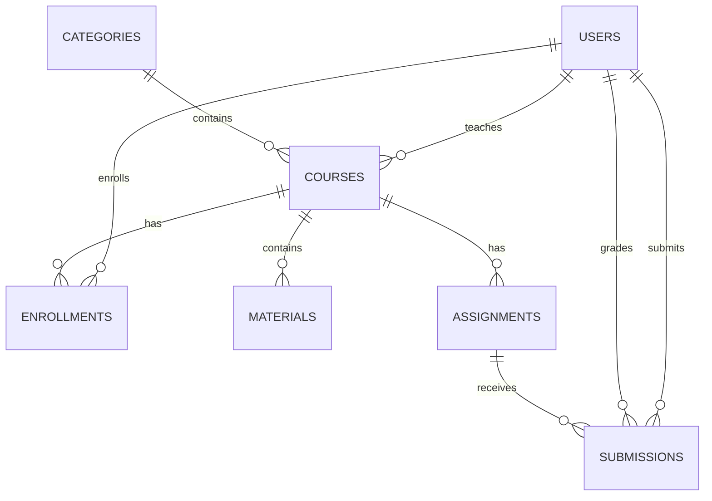

# Thiết kế Database

[README dự án](../README.md) · [Kiến trúc](architecture.md) · [API](api-docs.md)

Tài liệu phản ánh các Mongoose models trong [server/src/models](../server/src/models). Database cục bộ mặc định là `online_classroom`; tên database thực tế được lấy từ `MONGODB_URI`.

Mỗi collection có `_id: ObjectId`, `createdAt` và `updatedAt`. Các model bật timestamps và optimistic concurrency. Mongoose giữ trường phiên bản nội bộ `__v`; đây không phải phiên bản token đăng nhập.

## ERD



`gradedBy` chỉ có khi bài đã chấm. Các quan hệ cho biết tham chiếu giữa documents; MongoDB không tự bảo đảm role hoặc khóa ngoại bằng các đường nối này.

## 1. Users — `users`

Model: [User.js](../server/src/models/User.js).

| Trường | Kiểu | Quy tắc |
| --- | --- | --- |
| `fullName` | String | Bắt buộc, trim, tối đa 120 ký tự |
| `email` | String | Bắt buộc, trim/lowercase, tối đa 254 ký tự, duy nhất |
| `passwordHash` | String | Bắt buộc, select false; JSON không trả về |
| `tokenVersion` | Number | Mặc định 0, không âm, select false; JSON không trả về |
| `role` | String | admin/teacher/student, mặc định student |
| `isActive` | Boolean | Mặc định true |

Index: unique `{ email: 1 }`.

Mật khẩu đầu vào được validate và băm ở service, không lưu plaintext. Đổi/reset mật khẩu tăng tokenVersion để từ chối JWT cũ. Admin sửa hồ sơ Student/Teacher chỉ được đổi fullName/email; khóa và mật khẩu dùng API riêng. Không có API xóa người dùng trong phiên bản hiện tại.

## 2. Categories — `categories`

Model: [Category.js](../server/src/models/Category.js).

| Trường | Kiểu | Quy tắc |
| --- | --- | --- |
| `name` | String | Bắt buộc, tối đa 100 ký tự |
| `slug` | String | Bắt buộc, duy nhất; chữ thường ASCII, số, dấu gạch ngang |
| `description` | String | Mặc định rỗng, tối đa 2.000 ký tự |
| `isActive` | Boolean | Mặc định true |

Index: unique `{ slug: 1 }`.

Admin quản lý danh mục. Danh mục có Course tham chiếu không được xóa; có thể vô hiệu hóa. Khóa học mới và thao tác xuất bản yêu cầu danh mục hoạt động.

## 3. Courses — `courses`

Model: [Course.js](../server/src/models/Course.js).

| Trường | Kiểu | Quy tắc |
| --- | --- | --- |
| `title` | String | Bắt buộc, tối đa 200 ký tự |
| `description` | String | Bắt buộc, tối đa 20.000 ký tự |
| `teacher` | ObjectId → User | Bắt buộc, chủ sở hữu được gán từ Teacher xác thực |
| `category` | ObjectId → Category | Bắt buộc |
| `thumbnailUrl` | String | Tùy chọn, API nhận HTTP/HTTPS |
| `status` | String | draft/published/archived, mặc định draft |

Indexes: `{ teacher: 1, status: 1 }`, `{ category: 1, status: 1 }`.

Public chỉ xem danh sách published. Teacher sở hữu xem mọi trạng thái. Student ghi danh active/completed xem nội dung published/archived. Archived dừng ghi danh mới và nộp bài nhưng giữ quyền đọc của người học hợp lệ.

Chỉ xóa khóa học draft chưa có bất kỳ Enrollment hoặc Submission liên quan. Service dọn Materials và Assignments của khóa học khi xóa. Khóa học đã có ghi danh không được chuyển lại draft.

## 4. Enrollments — `enrollments`

Model: [Enrollment.js](../server/src/models/Enrollment.js).

| Trường | Kiểu | Quy tắc |
| --- | --- | --- |
| `student` | ObjectId → User | Bắt buộc, lấy từ Student xác thực |
| `course` | ObjectId → Course | Bắt buộc |
| `status` | String | active/completed/cancelled, mặc định active |
| `enrolledAt` | Date | Mặc định thời điểm ghi danh |
| `completedAt` | Date hoặc null | Mặc định null |

Indexes: unique `{ student: 1, course: 1 }`, `{ course: 1, status: 1 }`.

Ghi danh lại bản ghi cancelled cập nhật cùng document thành active, đặt lại enrolledAt và completedAt; không tạo bản ghi trùng. Hủy ghi danh giữ lại bài nộp/điểm. Completed giữ quyền đọc nội dung nhưng không nhận bài nộp mới. Chỉ Teacher sở hữu được đánh dấu hoàn thành, và không áp dụng cho cancelled.

## 5. Materials — `materials`

Model: [Material.js](../server/src/models/Material.js).

| Trường | Kiểu | Quy tắc |
| --- | --- | --- |
| `course` | ObjectId → Course | Bắt buộc |
| `title` | String | Bắt buộc, tối đa 200 ký tự |
| `type` | String | pdf/video/text |
| `content` | String | Bắt buộc cho text, tối đa 100.000 ký tự |
| `videoUrl` | String | Bắt buộc cho video, HTTP/HTTPS qua API |
| `file` | File metadata | Bắt buộc cho PDF |
| `position` | Number | Mặc định 0; API nhận số nguyên không âm |

Index: `{ course: 1, position: 1 }`.

API không cho đổi type của tài liệu đang có; tạo tài liệu mới khi đổi hình thức. Trường nội dung phải phù hợp type. MongoDB không lưu binary PDF.

## 6. Assignments — `assignments`

Model: [Assignment.js](../server/src/models/Assignment.js).

| Trường | Kiểu | Quy tắc |
| --- | --- | --- |
| `course` | ObjectId → Course | Bắt buộc |
| `title` | String | Bắt buộc, tối đa 200 ký tự |
| `description` | String | Bắt buộc, tối đa 20.000 ký tự |
| `dueAt` | Date hoặc null | Hạn nộp, null là không giới hạn |
| `maxScore` | Number | Lớn hơn 0, tối đa 10.000, mặc định 10 |
| `submissionType` | String | text/file/both |
| `status` | String | draft/published/closed, mặc định draft |

Index: `{ course: 1, dueAt: 1 }`.

API tạo bài tập luôn dùng draft. Khi có bài nộp: không xóa, không chuyển về draft, không đổi submissionType và không giảm maxScore xuống dưới điểm đã chấm. `both` cho phép text, file hoặc cả hai, nhưng cần ít nhất một dạng nội dung.

## 7. Submissions — `submissions`

Model: [Submission.js](../server/src/models/Submission.js).

| Trường | Kiểu | Quy tắc |
| --- | --- | --- |
| `assignment` | ObjectId → Assignment | Bắt buộc |
| `student` | ObjectId → User | Bắt buộc |
| `textAnswer` | String | Mặc định rỗng, tối đa 100.000 ký tự |
| `attachments` | File metadata[] | Mặc định [] |
| `submittedAt` | Date | Thời điểm nộp gần nhất |
| `status` | String | submitted/graded, mặc định submitted |
| `score` | Number hoặc null | Mặc định null, không âm |
| `feedback` | String | Mặc định rỗng, tối đa 10.000 ký tự |
| `gradedBy` | ObjectId → User | Teacher chấm, tùy chọn trước khi chấm |
| `gradedAt` | Date hoặc null | Mặc định null |

Index: unique `{ assignment: 1, student: 1 }`.

Service kiểm tra điểm không vượt Assignment.maxScore. Student phải có Enrollment active, khóa học/bài tập published và chưa quá dueAt để POST/PUT. Bài đã graded không cho Student sửa. Một document lưu phiên bản bài làm hiện tại; chưa lưu lịch sử các lần nộp.

## File metadata dùng chung

Schema: [shared.js](../server/src/models/shared.js).

```javascript
{
  _id: ObjectId,
  storageKey: String,   // tên UUID phía server, không trả JSON
  originalName: String,
  mimeType: String,
  size: Number         // byte, phải lớn hơn 0
}
```

File thực nằm trong UPLOAD_DIR. ID của phần tử attachments được dùng trong API tải file bài nộp. Client không tự chọn storageKey; trường này bị ẩn khỏi JSON kể cả khi backend chọn nó để phục vụ download.

## Indexes và bảo toàn dữ liệu

`connectDatabase` khởi tạo indexes của các models đã nạp trước khi phục vụ request. Unique index bảo vệ trùng dữ liệu; nó không phải validator của Mongoose và lỗi duplicate được xử lý thành 409.

Tham chiếu, role, quyền sở hữu, ghi danh và giới hạn điểm được kiểm tra ở các service/middleware. Các quy tắc nhiều document chưa được bảo vệ toàn bộ bằng transaction; xem [giới hạn nhất quán dữ liệu](architecture.md#7-nhất-quán-dữ-liệu-và-giới-hạn).
